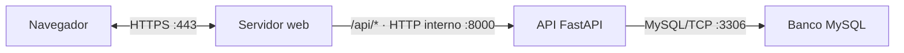

# Plano de infraestrutura de produção — Volta

Este documento descreve uma **arquitetura de produção proposta**. Ela ainda não está publicada e não escolhe provedor de nuvem, servidor web ou ferramenta de implantação.

## 1. Arquitetura de produção

Para testar no [mermaid.live](https://mermaid.live), cole somente o conteúdo do diagrama, começando em `flowchart LR`. Não cole as linhas de abertura e fechamento do bloco Markdown.

- **Navegador:** roda na máquina do usuário. É cliente e não precisa de uma porta de servidor publicada.
- **Servidor web:** roda em uma máquina de produção destinada à entrega da tela. Atende publicamente em `443` por HTTPS, serve os arquivos do frontend e recebe o tráfego público.
- **API FastAPI:** roda em uma máquina interna de produção na porta `8000`. Recebe somente as requisições encaminhadas pelo servidor web. A API atual possui rotas como `/login`, `/coletas` e `/usuarios`; o encaminhamento de `/api/*` para essas rotas exigirá uma regra de reescrita de prefixo? 
- **Banco MySQL:** roda em uma máquina ou serviço interno na porta `3306`. Não recebe tráfego público e aceita conexões da API.

A API e o servidor web podem ficar na mesma máquina interna ou em máquinas separadas? Essa decisão não aparece no código atual.

## 2. Desenvolvimento e produção

| Parte | Desenvolvimento atual | Produção proposta |
|---|---|---|
| **API** | FastAPI com Uvicorn. O README usa a porta `8000`; as rotas atuais não têm o prefixo `/api`. | Executar a API na porta interna `8000`, sem exposição direta. O servidor web encaminhará `/api/*` para ela. A estratégia de retirar ou preservar o prefixo `/api` precisa ser definida? |
| **Tela** | React com Vite. `npm run dev` usa `.env.development` e chama a API local na porta `8000`; o Vite atende a tela na porta `5173`. `npm run build` usa `.env.production` e gera arquivos estáticos. | Servir o build pelo servidor web na mesma origem HTTPS pública. `VITE_URL_DA_API=/api` aponta para o proxy da API. |
| **Banco** | SQLAlchemy usa `mysql+mysqlconnector`; o Alembic possui a migration inicial das tabelas `usuarios`, `coletas` e `pesagens`. | Usar MySQL interno na porta `3306`, aplicar as migrations antes da publicação e permitir acesso somente da API. |
| **`.env`** | `configuracao.py` lê `FRONTEND_ORIGIN`, `URL_DO_BANCO` e `CHAVE_DO_TOKEN`. O arquivo `.env.exemplo` documenta essas chaves sem valores reais. | Manter os valores de produção somente no ambiente do servidor. A URL deve apontar para o MySQL interno e a chave JWT deve ser exclusiva do ambiente de produção. |
| **CORS** | O backend permite origens locais de desenvolvimento e a origem configurada. | Como tela e API serão acessadas pela mesma origem pública, o navegador não precisará de comunicação cross-origin. Se o middleware continuar habilitado, deverá aceitar somente a origem pública definida. |

## 3. O caminho do login

1. **Clique no botão — máquina do usuário:** a pessoa preenche e-mail e senha na tela React e clica em **Entrar**.
2. **Montagem do formulário — máquina do usuário:** `TelaLogin` transforma os dados em `URLSearchParams`.
3. **Envio — máquina do usuário:** em produção, o frontend envia `POST /api/login` para o domínio HTTPS público. Em desenvolvimento, usa `VITE_URL_DA_API` definido em `.env.development`.
4. **Recepção — servidor web:** o servidor web recebe a requisição HTTPS na porta `443`.
5. **Encaminhamento — servidor web:** o servidor web encaminha `/api/login` para a API interna na porta `8000`. A regra para remover o prefixo `/api` ainda precisa ser definida? 
6. **Leitura do formulário — servidor da API:** FastAPI usa `OAuth2PasswordRequestForm` para ler `username` e `password`.
7. **Consulta — servidor da API e MySQL:** o serviço de usuário consulta o registro no MySQL usando a sessão SQLAlchemy.
8. **Verificação — servidor da API:** `seguranca.py` compara a senha recebida com o `senha_hash` usando Argon2.
9. **Token — servidor da API:** se a senha estiver correta, a API cria um JWT com o identificador do usuário e sua validade. A chave vem da configuração do ambiente.
10. **Resposta — API, servidor web e máquina do usuário:** a API devolve `access_token` e `token_type`; o servidor web devolve a resposta ao navegador por HTTPS.
11. **Armazenamento — máquina do usuário:** o React salva somente o token em `localStorage`.
12. **Perfil — máquina do usuário, servidor web e API:** o frontend envia o token no cabeçalho `Authorization: Bearer ...` e consulta `/api/usuarios/eu` para descobrir o tipo de usuário e abrir a tela correspondente.

## 4. O que está chumbado

| Arquivo e linha | Endereço | Uso | Onde roda |
|---|---|---|---|
| `frontend/src/Aplicativo.jsx:3` | `127.0.0.1:8000` | Fallback de `API_BASE_URL` quando `VITE_API_URL` não está definida. É usado pelo navegador para chamar a API durante o desenvolvimento. | Navegador |
| `backend/configuracao.py:12` | `localhost:5173` | Origem permitida pelo CORS para o frontend local. Não é uma porta de escuta do backend. | Servidor da API, comparando a origem enviada pelo navegador |
| `backend/configuracao.py:13` | `127.0.0.1:5173` | Segunda origem permitida pelo CORS para o frontend local. | Servidor da API, comparando a origem enviada pelo navegador |
| `backend/configuracao.py:19` | `localhost` | Host padrão do MySQL quando `URL_DO_BANCO` não está configurada. É usado pelo servidor, não pelo navegador. | Servidor da API |
| `backend/.env.exemplo:2` | `localhost` | Host de exemplo para o MySQL de desenvolvimento. É um modelo de configuração, não uma credencial. | Servidor da API |
| `README.md:47` | `127.0.0.1:8000` | Exemplo de comando para iniciar a API localmente na porta `8000`. | Servidor de desenvolvimento |
| `README.md:50` | `127.0.0.1:8000` | URL local para abrir a documentação do FastAPI no navegador. | Navegador |

Esses endereços não são todos erros. Os endereços de desenvolvimento precisam ser substituídos ou configurados para produção. O endereço do banco é usado apenas na comunicação interna do servidor e nunca deve ser usado pelo navegador.

## Perguntas para a apresentação

1. Por que o navegador deve acessar somente o servidor web pela porta `443`, enquanto a API `8000` e o MySQL `3306` permanecem internos?
2. Como o servidor web encaminhará `/api/login` para a rota atual `/login` da API sem modificar a estrutura de camadas do backend?
3. O que precisa mudar em `VITE_API_URL` e no CORS para que tela e API funcionem na mesma origem em produção?

